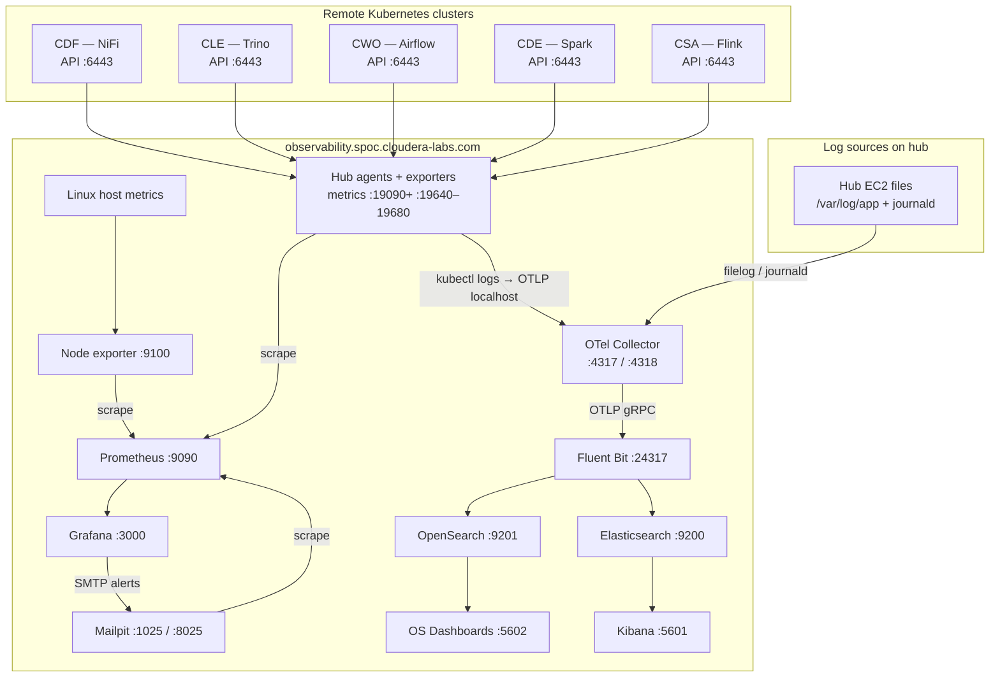

# UOB observability POC — setup guide

This guide explains how to build and use the **observability server**: one EC2 machine that collects **metrics**, **logs**, and **alert emails** for NiFi, Trino, Airflow, Spark, and Flink across your Cloudera environments.

It is written for someone following the repo scripts from a laptop, step by step.

---

## What you get when finished

| You can… | Using… |
|----------|--------|
| See charts and alert rules | **Grafana** (port 3000) |
| Query raw metrics | **Prometheus** (9090) |
| Search application logs | **Kibana** (5601) — start here for logs |
| Search logs with login | **OpenSearch Dashboards** (5602) |
| See alert emails (test inbox) | **Mailpit** (8025) |

Logs are stored under index names like **`uob-logs-2026.10.12`**.

For a diagram image in the repo, see **`RCA_Architecture.png`**.

---

## Architecture

### Hub server (observability EC2)

| Item | Value |
|------|--------|
| **DNS name** | `observability.spoc.cloudera-labs.com` |
| **Private IP (POC)** | `10.0.0.224` |
| **Public IP** | Changes on reboot — use the DNS name |
| **SSH** | `ec2-user@observability.spoc.cloudera-labs.com` port **22** |
| **OS** | Amazon Linux 2023 |

All URLs below use the hub DNS name unless noted **localhost only** (those listen on `127.0.0.1` on the server itself).

---

### Services on the hub — ports and URLs

| Service | Port(s) | URL or endpoint (from your laptop) | Login (POC) | Role |
|---------|---------|-------------------------------------|-------------|------|
| **SSH** | 22 | `observability.spoc.cloudera-labs.com:22` | SSH key `mail-server.pem` | Admin access |
| **Grafana** | 3000 | http://observability.spoc.cloudera-labs.com:3000 | `admin` / `admin` | Dashboards and alerts |
| **Prometheus** | 9090 | http://observability.spoc.cloudera-labs.com:9090 | None | Metrics database |
| **Node Exporter** | 9100 | http://observability.spoc.cloudera-labs.com:9100/metrics | None | CPU, disk, memory metrics |
| **Mailpit UI** | 8025 | http://observability.spoc.cloudera-labs.com:8025 | None | Read test alert emails |
| **Mailpit SMTP** | 1025 | `observability.spoc.cloudera-labs.com:1025` | None | Grafana sends alerts here |
| **Kibana** | 5601 | http://observability.spoc.cloudera-labs.com:5601 | None | **Main log search UI** — data view **UOB Logs** |
| **OpenSearch Dashboards** | 5602 | http://observability.spoc.cloudera-labs.com:5602 | `admin` / `MyAdmin123!@#POC` | Log UI with login |
| **OpenSearch API** | 9201 | http://observability.spoc.cloudera-labs.com:9201 | Same as Dashboards (HTTP basic) | Log storage API (not a browser UI) |
| **OTel Collector (gRPC)** | 4317 | `observability.spoc.cloudera-labs.com:4317` | None | Send logs/metrics (OTLP gRPC) |
| **OTel Collector (HTTP)** | 4318 | http://observability.spoc.cloudera-labs.com:4318 | None | Send logs (OTLP HTTP) |
| **Elasticsearch** | 9200 | **localhost only** on server | None (POC) | Kibana backend; mirror of `uob-logs-*` |
| **Fluent Bit (OTLP in)** | 24317 | **localhost only** | — | OTel → Fluent Bit bridge |
| **OTel health** | 13133 | **localhost only** | — | Collector health check |

**Typical security group (POC):** allow your IP inbound on **22, 3000, 5601, 5602, 8025, 9090, 9201, 4317, 4318** (and **9100** if you scrape Node Exporter from outside).

**Grafana dashboards (after setup):**

| Product | Dashboard URL |
|---------|----------------|
| Trino | http://observability.spoc.cloudera-labs.com:3000/d/trino-cle-obs/trino-cle |
| Airflow | http://observability.spoc.cloudera-labs.com:3000/d/airflow-cwo-obs/airflow-cwo |
| Spark | http://observability.spoc.cloudera-labs.com:3000/d/spark-cde-obs/spark-cde |
| Flink | http://observability.spoc.cloudera-labs.com:3000/d/flink-csa-obs/flink-csa |

---

### Hub agents and metrics exporters (localhost on EC2)

These run as **systemd** services on the observability server. They use **kubeconfig** files under `/etc/prometheus/kubeconfig/` to talk to remote clusters. Prometheus on the same machine scrapes the **127.0.0.1** ports.

| systemd service | Kubeconfig | Local metrics port | Prometheus job name | What it collects |
|-----------------|------------|--------------------|---------------------|------------------|
| `nifi-hub-agent` | `cdf.yaml` | **19090+** (one port-forward per NiFi deployment) | `nifi_federate` | Federates DFX Prometheus (`job=dfx-nifi-web`); streams NiFi **app-log** logs to OTel |
| `nifi-status-exporter` | `cdf.yaml` | **19680** | `nifi_status` | NiFi processor run/stop state (optional; script `22_`) |
| `trino-hub-agent` | `cle.yaml` | **19640** (status exporter) | `trino` | Trino health + coordinator/worker logs |
| `airflow-hub-agent` | `cwo.yaml` | **19650** | `airflow` | Airflow health + scheduler logs |
| `spark-hub-agent` | `cde.yaml` | **19660** | `spark` | SparkApplication status + operator logs |
| `flink-hub-agent` | `csa.yaml` | **19670** | `flink` | FlinkDeployment / SessionJob status + logs |

Other Prometheus jobs on the hub: **`prometheus`**, **`node_exporter`**, **`mailpit`**, optional Knox scrape **`nifi`** (often down — federation is preferred).

Dynamic scrape targets are written to **`/etc/prometheus/file_sd/*.json`** (e.g. `nifi_federate.json`, `trino_metrics.json`).

---

### Remote Cloudera / Kubernetes clusters (spokes)

The observability server does **not** run these apps. It connects to each cluster’s **Kubernetes API** (port **6443**, private network). You need network path (VPN, bastion, or `start_tunnel.sh`) from the hub to those APIs.

| Product | Local kubeconfig file | On EC2 as | Cluster (context) | Kubernetes API (POC) | Example app hostname / notes |
|---------|----------------------|-----------|-------------------|------------------------|------------------------------|
| **NiFi (CDF)** | `cdf_kubeconfig.yaml` | `/etc/prometheus/kubeconfig/cdf.yaml` | `cdf01-1-8` | `https://10.0.13.75:6443` | Namespace `dfx-nifi-deployment-ns`; DFX Prometheus `svc/prometheus:19090`; NiFi metrics job `dfx-nifi-web` |
| **Spark (CDE)** | `cde_kubeconfig.yaml` | `cde.yaml` | `cde01-1-5` | `https://10.0.12.167:6443` | Spark operator / SparkApplication CRs |
| **Flink (CSA)** | `csa_kubeconfig.yaml` | `csa.yaml` | `csa01-1-9` | `https://10.0.14.134:6443` | e.g. namespace `csa01-csa-0ecfd9` |
| **Trino (CLE)** | `cle_kubeconfig.yaml` | `cle.yaml` | `cle01-1-10` | `https://10.0.13.81:6443` | e.g. `cle01-trino-f80f2a.cle01.spoc.cloudera-labs.com` (Trino UI) |
| **Airflow (CWO)** | `cwo_kubeconfig.yaml` | `cwo.yaml` | `cwo01-1-12` | `https://10.0.15.135:6443` | e.g. `cwo01-cwo-airflow-api-server.cwo01.spoc.cloudera-labs.com` |
| **CAI** | `cai_kubeconfig.yaml` | `cai.yaml` | `cai01-1-6` | `https://10.0.9.150:6443` | Copied by `08_`; **no hub agent yet** |
| **Polaris** | `polaris_kubeconfig.yaml` | `polaris.yaml` | `polaris-1-16` | `https://10.0.9.145:6443` | Copied by `08_`; **no hub agent yet** |

Optional NiFi metrics path (less reliable in POC): HTTPS via Knox at **`cdf.cdf01.spoc.cloudera-labs.com`** with env **`KNOX_NIFI_JWT`**.

Each cluster also runs platform monitoring in namespace **`ccf-monitoring`** (in-cluster Prometheus, Loki, etc.) — this POC mostly **pulls from product namespaces** via hub agents instead of duplicating that stack on EC2.

---

### How data flows

**Metrics**

```text
Remote cluster (e.g. NiFi DFX Prometheus :19090)
    → kubectl port-forward (nifi-hub-agent) → 127.0.0.1:19090+
    → Prometheus job nifi_federate (/federate?match[]={job="dfx-nifi-web"})
    → Grafana (Prometheus datasource http://localhost:9090)

Trino / Airflow / Spark / Flink:
    → hub agent + small status exporter on 127.0.0.1:19640–19670
    → Prometheus jobs trino | airflow | spark | flink
    → Grafana
```

**Logs**

```text
Sources:
  • /var/log/app/* on the hub
  • journald on the hub
  • kubectl logs (app-log, Trino/Airflow/Spark/Flink pods) via hub agents → OTLP to **127.0.0.1:4318** on the hub

otelcol-contrib (:4317 gRPC, :4318 HTTP)
    → OTLP gRPC → Fluent Bit (:24317)
    → OpenSearch (:9201) + Elasticsearch (:9200)   ← primary search (Kibana / Dashboards)
    → S3 s3://uob-application-logs/logs/fluent-bit/…   ← optional archive (script 23_)

Index pattern: uob-logs-YYYY.MM.DD
Search in Kibana: field log, time Last 24 hours

Metrics (Prometheus TSDB on disk at /var/lib/prometheus):
    → daily snapshot upload to s3://uob-application-logs/metrics/prometheus/… (script 23_, timer 03:15 UTC)
    Grafana still queries live Prometheus — S3 is backup / DR, not a live datasource.
```

**Should you use S3?** Yes, as **backup** alongside OpenSearch/Prometheus on the VM: if the EC2 disk dies, you still have gzipped log batches and Prometheus snapshots in **`uob-application-logs`**. Run **`./23_setup-s3-archive.sh`** once (already applied on the POC host). Not a replacement for Kibana/Grafana for day-to-day search.

**Alerts**

```text
Grafana alert rules (Prometheus + some Elasticsearch log rules)
    → SMTP → Mailpit (:1025)
    → Web inbox (:8025)
Each rule uses a distinct test address: <rule-id>@local.test (domain: ALERT_DOMAIN)
Routing shared module: scripts/grafana_alerting.py
```

**Where Node Exporter and OTel get data**

| Component | Data source | What it is |
|-----------|-------------|------------|
| **Node Exporter :9100** | The **observability EC2 itself** (Linux kernel) | CPU, memory, disk, network — Prometheus **scrapes** Node Exporter; nothing pushes to it. |
| **OTel Collector** | Several **inputs on the same server** (see below) | Batches log records and forwards them to Fluent Bit; it is **not** tied to Kubernetes APIs directly. |

**OTel log inputs (receivers):**

| Receiver | Where the data comes from |
|----------|---------------------------|
| **filelog** | Files on the hub, e.g. `/var/log/app/*.log` |
| **journald** | Selected systemd units on the hub (Prometheus, Grafana, Fluent Bit, …) |
| **OTLP :4317 / :4318** | In this POC, only **hub agents on the same machine** send logs here (HTTP to `127.0.0.1:4318`). Ports are open for future use, but **no separate app-server agents are deployed** (verified on the live hub). |

So in the diagram, OTel and Node Exporter connect to **host + log senders**, not to the Kubernetes API boxes. Cluster boxes only feed **hub agents**, which split traffic: **metrics → Prometheus**, **logs → OTel**.

**Diagram (hub and spokes)**



No extra logging DaemonSets are installed in application namespaces for this POC — the hub uses **kubectl** from EC2.

**Verified on live hub (`observability.spoc.cloudera-labs.com`):** all five hub agents and `nifi-status-exporter` are **active**; OTel exports to Fluent Bit only (not the direct-OpenSearch pattern from `99_setup-app-server.sh`); no `uob-application-logs` S3 config; OTLP clients on `:4318` are **127.0.0.1 only** (hub agents). Logs in OpenSearch are from **`uob.product=*`** hub streams (NiFi, Trino, Airflow, Spark, Flink).

---

### Log and config paths (on the hub server)

| Path | Purpose |
|------|---------|
| `/etc/prometheus/prometheus.yml` | Prometheus scrape config |
| `/etc/prometheus/kubeconfig/*.yaml` | Cluster credentials |
| `/etc/prometheus/file_sd/*.json` | Dynamic scrape targets from hub agents |
| `/opt/otelcol/config/config.yaml` | OpenTelemetry Collector |
| `/etc/fluent-bit/fluent-bit.conf` | Fluent Bit |
| `/etc/opensearch/opensearch.yml` | OpenSearch |
| `/root/opensearch-ui.env` | OpenSearch admin password |
| `/opt/uob-nifi-hub-agent/` | NiFi hub + status exporter scripts |
| `/opt/uob-k8s-log-forwarder/` | kubectl → OTel log helper |

---

## Before you start

### On the observability server

- **OS:** Amazon Linux 2023
- **DNS (use this, not a changing public IP):** `observability.spoc.cloudera-labs.com`
- **SSH:** user `ec2-user`, key file `mail-server.pem` (keep it out of git)

### On your laptop

- This repo cloned (`uob_poc`)
- `ssh`, `scp`, `bash`
- Python 3 (used by some setup scripts)

### Secret files (repo root — never commit)

| File | Purpose |
|------|---------|
| `mail-server.pem` | SSH to the observability server |
| `cdf_kubeconfig.yaml`, `cde_kubeconfig.yaml`, `csa_kubeconfig.yaml`, `cle_kubeconfig.yaml`, `cwo_kubeconfig.yaml`, … | Login to each Kubernetes cluster |
| `KNOX_NIFI_JWT` (optional env var) | Optional direct NiFi metrics URL; federation is the reliable path |

Script **`08_setup-hub-kubeconfigs.sh`** copies the kubeconfig files to the server at  
`/etc/prometheus/kubeconfig/` (one file per cluster, e.g. `cdf.yaml` for NiFi).

**Network:** The observability server must reach each cluster API (port 6443). If that only works through a bastion, use **`start_tunnel.sh`** (local file, not in public git) and tunnel-style kubeconfigs before running hub scripts.

### Which cluster file goes with which product

| Product | Kubeconfig on server | Setup scripts |
|---------|----------------------|---------------|
| NiFi | `cdf.yaml` | `09_`, `11_`, `22_`, `12_` |
| Trino | `cle.yaml` | `13_`, `14_` |
| Airflow | `cwo.yaml` | `15_`, `16_` |
| Spark | `cde.yaml` | `18_`, `19_` |
| Flink | `csa.yaml` | `20_`, `21_` |

Grafana, Prometheus, Mailpit, and local file logs **do not** need kubeconfig files.

---

## Step-by-step setup

Run from the **repo root** unless a step says **on the server with sudo**.

Many scripts SSH from your laptop to the server. If your key or hostname differ, set `SSH_KEY` and `EC2_HOST` (see script headers) or edit the defaults inside the scripts.

### Part 1 — Core monitoring (laptop)

| Step | Command | What it does |
|------|---------|--------------|
| 1 | `./01_setup-grafana.sh` | Installs Grafana on the server |
| 2 | `./02_setup-prometheus.sh` | Installs Prometheus and Node Exporter |
| 3 | `./03_setup-mailpit.sh` | Installs fake SMTP + web inbox for alerts |

**Check:** SSH in and run:

```bash
curl -s http://localhost:9090/-/healthy
curl -s -u admin:admin http://localhost:3000/api/health
```

In Grafana (browser), add a **Prometheus** data source pointing to `http://localhost:9090` if it is not already there.

---

### Part 2 — Log storage and pipeline (on server)

Copy scripts to the server if needed, then run with **sudo** on the observability host:

| Step | Command | What it does |
|------|---------|--------------|
| 4 | `sudo ./04_setup-otel-opensearch.sh` | OpenSearch on port **9201** |
| 5 | `sudo ./05_setup-observability-log-pipeline.sh` | OpenTelemetry Collector + Fluent Bit; OTLP ports **4317** / **4318** |
| 6 | `./06_setup-kibana-uob-logs.sh` | Kibana data view **UOB Logs** |
| 7 | `sudo ./07_setup-opensearch-dashboards-ui.sh` | Secured OpenSearch UI on **5602** |

**Check:**

```bash
sudo systemctl status otelcol-contrib fluent-bit opensearch
curl -u 'admin:MyAdmin123!@#POC' -s http://127.0.0.1:9201/_cat/indices/uob-logs*?v
```

Write a test line: `echo "smoke $(date -Is)" | sudo tee -a /var/log/app/smoke.log` — then look in Kibana (**Last 24 hours**, index pattern `uob-logs-*`, field **`log`**).

---

### Part 3 — Cluster access (laptop)

| Step | Command | What it does |
|------|---------|--------------|
| 8 | `./08_setup-hub-kubeconfigs.sh` | Uploads kubeconfig files to the server |

**Check** (on server):

```bash
for k in cdf cde csa cle cwo; do
  echo -n "$k: "
  kubectl --kubeconfig=/etc/prometheus/kubeconfig/${k}.yaml get ns --request-timeout=10s 2>&1 | head -1
done
```

You need Part 3 before any **hub agent** (NiFi, Trino, Airflow, Spark, Flink).

---

### Part 4 — NiFi metrics and logs

| Step | Where | Command | What it does |
|------|--------|---------|--------------|
| 9 | Laptop | `./09_setup-nifi-prometheus.sh` | Optional Knox scrape; prepares NiFi-related Prometheus config |
| 10 | Server sudo | `sudo ./10_setup-k8s-console-logs-to-otel.sh` | Tools for streaming pod logs to OTel |
| 11 | Laptop | `./11_setup-nifi-auto-discovery.sh` | **nifi-hub-agent**: NiFi metrics federation + **app-log** container logs |

**Recommended order for NiFi alerts that include “processor stopped”:**

1. Run step **11** first.  
2. Run step **22** (status exporter) — see Part 4b below.  
3. Run step **12** (Grafana NiFi alerts).  
4. If you already ran **12** before **22**, run **12** again after **22** so everything stays in sync.

**Check NiFi metrics and logs:**

```bash
sudo systemctl status nifi-hub-agent
cat /etc/prometheus/file_sd/nifi_federate.json
curl -s --data-urlencode 'query=count({__name__=~"nifi_.*"})' http://localhost:9090/api/v1/query
```

NiFi application logs use the **`app-log`** sidecar, not the main `nifi` container.

---

### Part 4b — NiFi “is the processor running?” (optional but recommended)

| Step | Command | What it does |
|------|---------|--------------|
| 22 | `./22_setup-nifi-status-exporter.sh` | Polls NiFi flow state; exposes metrics for “processor not running” alerts |

**Check:**

```bash
systemctl status nifi-status-exporter
curl -s http://127.0.0.1:19680/metrics | grep nifi_processor_run_status | head
```

Then run **`./12_setup-grafana-nifi-alerts.sh`** if you have not already (or run it again).

---

### Part 4c — NiFi Grafana alerts (laptop)

| Step | Command | What it does |
|------|---------|--------------|
| 12 | `./12_setup-grafana-nifi-alerts.sh` | NiFi alert rules + email routing via Mailpit |

**NiFi alert rules (Hello World flow by default):**

| Alert | Meaning |
|-------|---------|
| Bulletin | Warning or error showing on NiFi’s bulletin board |
| Thread terminated | Processor thread died (often a crash) |
| Failure counter | Failure-related counters going up |
| Queue stalled | Files sitting in a queue and not moving (deep queue) |
| Processor not running | Processor is stopped or not in RUNNING state (needs step **22**) |

To watch a **different NiFi flow**, set `NIFI_PARENT_ID`, `NIFI_FLOW_TITLE`, and related env vars (see script `12_` and `scripts/update_grafana_nifi_alerts.py`) before running step **12**.

Import a NiFi Grafana dashboard manually if you have a JSON export; the repo’s `backups/` folder includes dashboards for Trino, Airflow, Spark, and Flink.

---

### Part 5 — Trino (laptop)

| Step | Command |
|------|---------|
| 13 | `./13_setup-trino-hub-agent.sh` |
| 14 | `./14_setup-grafana-trino-alerts.sh` |

If Trino or Airflow **log panels in Grafana are empty**, run once: **`./17_fixup-airflow-trino-observability.sh`**.

---

### Part 6 — Airflow (laptop)

| Step | Command |
|------|---------|
| 15 | `./15_setup-airflow-hub-agent.sh` |
| 16 | `./16_setup-grafana-airflow-alerts.sh` |

---

### Part 7 — Spark (laptop)

| Step | Command |
|------|---------|
| 18 | `./18_setup-spark-hub-agent.sh` |
| 19 | `./19_setup-grafana-spark-alerts.sh` |

*(There is no script numbered 17 in the main sequence — `17_` is a fix-up utility.)*

---

### Part 8 — Flink (laptop)

| Step | Command |
|------|---------|
| 20 | `./20_setup-flink-hub-agent.sh` |
| 21 | `./21_setup-grafana-flink-alerts.sh` |

---

## Quick reference — all setup scripts

| # | Script | Run from |
|---|--------|----------|
| 01 | `01_setup-grafana.sh` | Laptop |
| 02 | `02_setup-prometheus.sh` | Laptop |
| 03 | `03_setup-mailpit.sh` | Laptop |
| 04 | `04_setup-otel-opensearch.sh` | Server (sudo) |
| 05 | `05_setup-observability-log-pipeline.sh` | Server (sudo) |
| 06 | `06_setup-kibana-uob-logs.sh` | Server |
| 07 | `07_setup-opensearch-dashboards-ui.sh` | Server (sudo) |
| 08 | `08_setup-hub-kubeconfigs.sh` | Laptop |
| 09 | `09_setup-nifi-prometheus.sh` | Laptop |
| 10 | `10_setup-k8s-console-logs-to-otel.sh` | Server (sudo) |
| 11 | `11_setup-nifi-auto-discovery.sh` | Laptop |
| 12 | `12_setup-grafana-nifi-alerts.sh` | Laptop |
| 13 | `13_setup-trino-hub-agent.sh` | Laptop |
| 14 | `14_setup-grafana-trino-alerts.sh` | Laptop |
| 15 | `15_setup-airflow-hub-agent.sh` | Laptop |
| 16 | `16_setup-grafana-airflow-alerts.sh` | Laptop |
| 17 | `17_fixup-airflow-trino-observability.sh` | Laptop (fix-up only) |
| 18 | `18_setup-spark-hub-agent.sh` | Laptop |
| 19 | `19_setup-grafana-spark-alerts.sh` | Laptop |
| 20 | `20_setup-flink-hub-agent.sh` | Laptop |
| 21 | `21_setup-grafana-flink-alerts.sh` | Laptop |
| 22 | `22_setup-nifi-status-exporter.sh` | Laptop |
| 23 | `23_setup-s3-archive.sh` | Laptop — S3 backup for logs + Prometheus snapshots |

Scripts are **safe to re-run**; they try to be idempotent.

`99_setup-app-server.sh` exists in the repo as an **unused optional** pattern (remote OTel → OpenSearch + S3). It was **not run** in this POC.

---

## Open the apps (POC URLs and logins)

Replace the hostname with yours if different.

| App | URL | Login |
|-----|-----|--------|
| **Kibana** (best for log search) | http://observability.spoc.cloudera-labs.com:5601 | None in POC. Data view: **UOB Logs**, field **`log`**, time **Last 24 hours**. |
| **OpenSearch Dashboards** | http://observability.spoc.cloudera-labs.com:5602 | `admin` / `MyAdmin123!@#POC` |
| **Grafana** | http://observability.spoc.cloudera-labs.com:3000 | `admin` / `admin` |
| **Prometheus** | http://observability.spoc.cloudera-labs.com:9090 | None |
| **Mailpit** (alert inbox) | http://observability.spoc.cloudera-labs.com:8025 | None |

**OpenSearch API** (not a UI): port **9201**, same admin password as Dashboards.

**Send logs in:** OTLP HTTP `http://observability.spoc.cloudera-labs.com:4318` or gRPC on port **4317**.

Server password file (on EC2): `/root/opensearch-ui.env`.

Do not expose OpenSearch ports to the open internet without hardening.

---

## How alert email works (simple)

- All services share one routing module: **`scripts/grafana_alerting.py`**.
- Each alert rule gets its own “to” address like `nifi-proc-bulletin@local.test` (domain from **`ALERT_DOMAIN`**, default `local.test`).
- Mail goes to **Mailpit**, not real users — open port **8025** to read messages.
- Re-running any `12_` / `14_` / `16_` / `19_` / `21_` script refreshes rules and routing together; order between those scripts does not matter much.
- Old per-service email env vars such as `NIFI_ALERT_EMAIL` are **ignored**; use **`ALERT_DOMAIN`** instead.

---

## If something goes wrong

| Problem | What to try |
|---------|-------------|
| No NiFi metrics in Grafana | `sudo systemctl status nifi-hub-agent`; check `/etc/prometheus/file_sd/nifi_federate.json` |
| No logs in Kibana | Use **5601** (not 9201 in a browser); widen time range; confirm data view **UOB Logs** exists (run `06_`) |
| NiFi logs missing | Hub agent must use container **`app-log`**; `journalctl -u nifi-hub-agent` |
| OpenSearch returns 401 | Use `admin` and the POC password, or log in via Dashboards on **5602** |
| Trino/Airflow Grafana log panels empty | Run `./17_fixup-airflow-trino-observability.sh`; run a query or DAG so logs exist |
| Grafana dashboard variables empty | Hub agent may not write `file_sd` JSON — often fixed by `sudo chown ec2-user:ec2-user /etc/prometheus/file_sd/*.json` and restarting the hub agent (or run `17_`) |
| “Processor stopped” never alerts | Run **`22_`** then **`12_`**; confirm metrics on `http://127.0.0.1:19680/metrics` |
| Stopping a processor silently | Without **22_**, only **queue stalled** might catch it — and only if the queue had enough files backed up |

**Useful commands on the server:**

```bash
ssh -i mail-server.pem ec2-user@observability.spoc.cloudera-labs.com

sudo systemctl status prometheus grafana-server otelcol-contrib fluent-bit \
  nifi-hub-agent trino-hub-agent airflow-hub-agent spark-hub-agent flink-hub-agent

curl -s http://localhost:9090/api/v1/targets | python3 -m json.tool | head -80
```

---

## Repo layout (what folders mean)

| Path | Purpose |
|------|---------|
| `01_` … `22_` `*.sh` | Setup automation |
| `scripts/` | Hub agents, alert updaters, log forwarders |
| `backups/` | Grafana dashboard JSON (Trino, Airflow, Spark, Flink) |
| `docs/` | Longer architecture notes (local / internal copy) |

Alert logic for all products: **`scripts/grafana_alerting.py`** plus **`scripts/update_grafana_*_alerts.py`**.

---

## Production vs this POC

This setup is for **learning and demo**, not production as-is:

- Default passwords and open ports
- No high availability
- Hub agents use cluster login files on one server
- Mailpit instead of real on-call email

For a longer multi-cluster strategy, see **`docs/OBSERVABILITY_PLAN.md`** (if present in your checkout). For NiFi metrics inside the cluster (not this EC2 hub), see **`docs/NIFI_IN_CLUSTER_GRAFANA.md`**.

---

## Security reminders

- Never commit `.pem` keys, kubeconfigs, or JWT tokens.
- Rotate passwords before sharing the environment.
- Restrict security group access to known IPs.

---

*Guide version: simplified layout for step-by-step use. Observability host: `observability.spoc.cloudera-labs.com`.*
